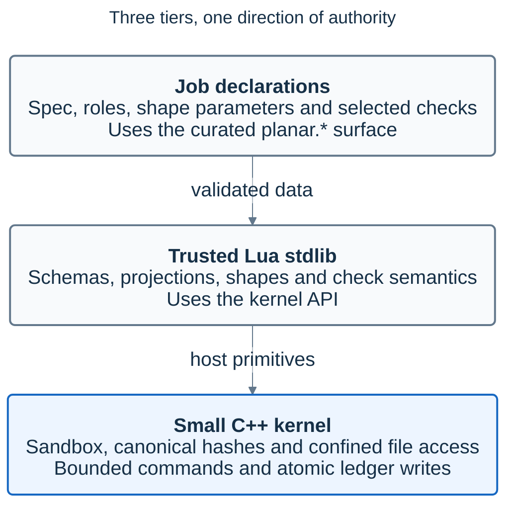
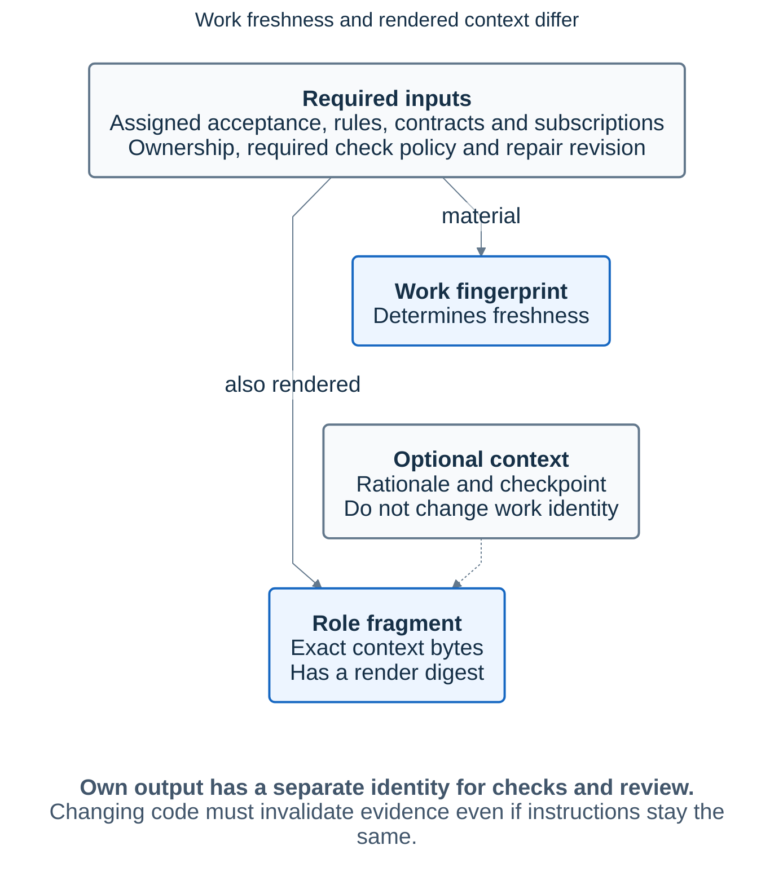
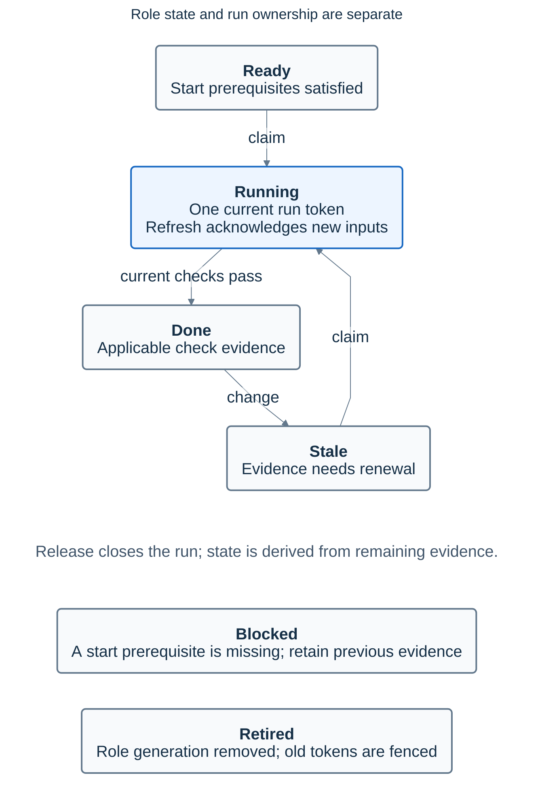
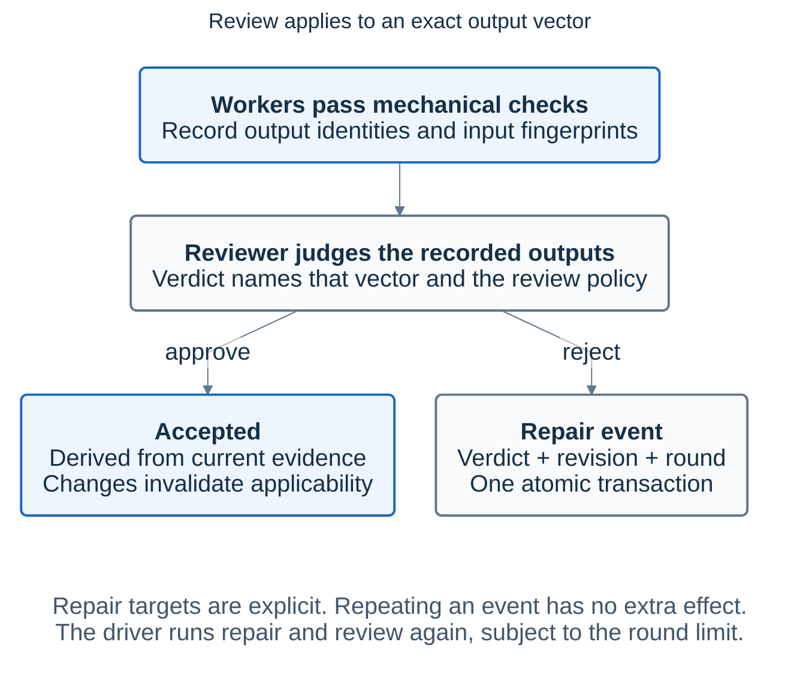
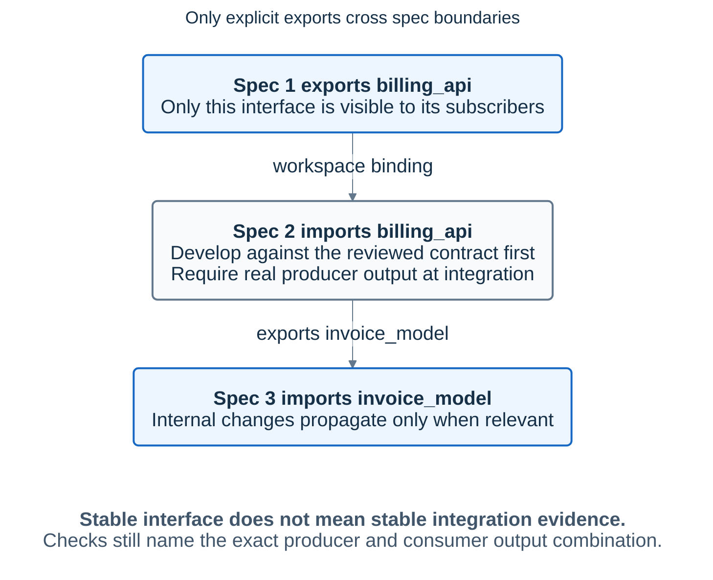
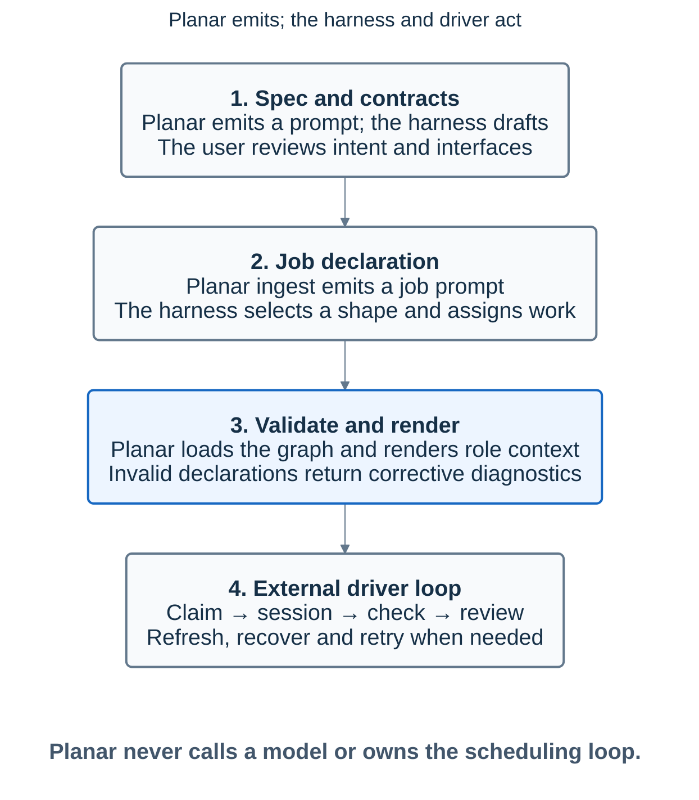

# Planar design spec: kernel, stdlib, job tiers

Revision 4 · Updated October 19, 2026 · Context-plane design

This revision supersedes v3 as the proposed design baseline. It returns to v2’s Lua-first context plane and integrates the two review rounds. The accompanying fixture is an executable design example, not the production Planar runtime. The six diagrams are editable Mermaid conversions of the v4 figures, which were redrawn from the five originals recovered from v2’s DOCX with corrected semantics. The PNG and SVG figures remain available as visual references.

## Scope

Planar turns a Lua specification into useful per-role Markdown, compares declared inputs to identify work that needs attention, and records deterministic check results against the exact work observed. It never calls a model or runs a scheduling loop. The driver runs sessions, supplies checkouts, handles process interruption, and decides when to invoke Planar.

Planar emits prompts, the harness thinks, Planar validates what came back.

The product remains useful even if ordinary Markdown files perform equally well in a compaction experiment. Scoped context, visible requirements, contract-first parallel work, and explainable invalidation are independently useful. Compaction, grouping, and model comparisons are separate later experiments.

The approved [implementation plan](implementation.md) supersedes legacy
coexistence and migration language in this design. Exact first-slice APIs are
[declaration v1](declarations.md) and [render v1](render-contract.md); illustrative
syntax elsewhere is not an additional supported CLI or constructor.

The first implementation is render-only. Persistence and finite check/review operations follow after evaluating the rendered fragments. An object archive, managed worktrees, read-only verification mounts, authenticated human approvals, session supervision, and OS isolation are optional adapters or future products. None is required to render useful context.

## Architecture and trust



| Tier | Owns | Can access |
| --- | --- | --- |
| Job | Spec, role assignments, shape parameters, selected checks | Curated constructors and captured file references |
| Stdlib | Schemas, shapes, projections, normalizers, reconciliation, check definitions, prompt templates | Kernel primitives |
| Kernel | Lua isolation, canonical serialization and hashing, confined file primitives, bounded subprocesses, conditional atomic ledger writes | Host services required by those primitives |

The kernel is small C++ with modules and `std::expected` at host boundaries. Trusted Lua contains the changing product logic. A job cannot replace the stdlib, define a projection, run a subprocess, or write the ledger. The stdlib is trusted: a wrong normalizer or inadequate check remains a product bug, even if the kernel transaction is correct.

Kernel confinement applies to its own file operations. A build command is a subprocess with the driver’s OS permissions; restricting `kernel.write` does not confine that process or an agent. The default execution contract assumes cooperative sessions, a trusted driver, and source files held stable during checks. Stronger enforcement can be supplied by an adapter with explicitly advertised guarantees.

## Declared model

`workspace.lua`, `spec.lua`, and `job.lua` return versioned data through constructors. Unknown fields, unresolved references, duplicate IDs, invalid scope, and unsupported schema versions are load errors with file, line where available, field path, and a corrective message.

| Artifact | Meaning |
| --- | --- |
| Workspace | Roots, toolchain registry, specs, active jobs, cross-spec bindings |
| Spec | Goal, stable work units and milestones, constraints, prescriptions, contracts, work-scoped layout, questions, imports and exports |
| Job | Shape, role definitions, work-to-role assignments, model/session preferences, subscriptions, check selections and budgets |
| Shape | Trusted workflow rules such as fan-out followed by review; no internal session loop |
| Role | A job-defined unit of context and state with assigned work units and derived owned paths |
| Facet | A named observable output, such as an interface or a diff |
| Contract | Reviewed expected interface plus an explicit conformance check |
| Ledger | Observed state, run identities, input manifests, check evidence and review events |
| Inbox | Session proposals; editing a proposal never changes authority |

### Work belongs to the spec; roles belong to the job

The spec defines stable work units, their milestone acceptance criteria, dependencies, contracts and path boundaries. It does not name worker roles or models. `layout.work`, prescription scopes and question scopes refer to work-unit IDs (or an explicit global scope), never job role names. Contract producers, consumers and exported facets likewise refer to stable work units. Frozen user-owned paths remain explicitly outside worker ownership.

The job defines roles and assigns work units to them. Each required work unit must have exactly one implementing role in an active job. A role may implement several units; several roles may cover distinct units under the same milestone. This supports different groupings without editing the spec. The smallest assignable unit is a declared work unit: splitting an indivisible unit into simultaneous writers requires refining its boundaries, not silently duplicating ownership. Redundant trials of the same unit require separate execution views and experiment runs; they are not shared writers in one job.

Requirements, contracts, questions, mandatory checks and owned paths are derived from the union of a role's assigned work. Jobs may add checks or stricter policy but cannot drop requirements, leave required work unassigned, grant paths outside declared boundaries or weaken mandatory review separation. Validation rejects duplicate assignments, unknown units, ambiguous path ownership and incompatible shapes. A job that narrows a role's write scope must still assign every required writable boundary to an implementing role.

Dependencies remain expressed between work units. When a job groups their endpoints into one role, Planar retains the contract and completion obligations without creating a self-wait on that role's own `done` state. Cross-role dependencies resolve through the job's assignment map. Any resulting unsatisfiable scheduling cycle is rejected with the affected work units and roles identified. Reviewer roles are defined by the job/shape and target work units; their context includes those units' acceptance criteria and required evidence. A reviewer cannot implement the work it approves.

For example, one unchanged spec declares `library` and `command` work units, their path boundaries and a library-to-command dependency. A job can assign both units to one `builder`, or assign them separately to `library_worker` and `cli_worker`; each job supplies an independent reviewer. Both jobs must satisfy the same acceptance criteria and integration checks. These are illustrative assignment maps, not a finalized Lua constructor API:

```text
job together: builder = [library, command]; reviewer reviews [library, command]
job split:    library_worker = [library]; cli_worker = [command]
              reviewer reviews [library, command]
```

A job may also declare model/session preferences and budgets per role; the driver resolves and executes them and records the actual configuration. Planar does not call models. Model identity alone does not change a work requirement or automatically invalidate accepted evidence, but requested and actual model configurations belong in experiment provenance. Changing grouping changes role assignments/generations and cannot inherit run tokens or approvals merely by reusing a role name.

Manual grouping is supported from the first render gate. Automated grouping/search is deferred. Controlled experiments keep the spec revision, source baseline and evaluation criteria fixed, identify each job configuration and independent trial, and record actual model settings, budgets and outcomes. Grouping and model choice can then be varied independently. Sequentially switching a job on an already-completed workspace is not by itself a controlled comparison; trials need isolated state and equivalent starting views supplied by the driver.

`md [[...]]` holds inline prose; `file "docs/goal.md"` captures a file relative to the declaring document. A file reference inherits the materiality of its destination field. A mandatory constraint in a Markdown file is material. Rationale and nonbinding background may be immaterial. Enforced conventions belong in constraints or prescriptions, not in an immaterial style-guide field.

Schemas reject attempts to wrap mandatory requirements, contracts, ownership, required subscriptions, or required check policy in `immaterial`. Optional notes may use that wrapper. Functions, cyclic tables, metatables, mixed map/array structures and unsupported numeric values cannot become declaration values.

Shapes are few and hand-written. Start with a pipeline and fan-out followed by review. A refusal to express a real workflow is evidence for a new shape; the harness cannot introduce arbitrary workflow code in a job.

## Identity and materiality



Four identities serve different questions:

| Identity | Contents | Question |
| --- | --- | --- |
| Observation digest | Exact source bytes, paths, modes and types for an observation | What did Planar read? |
| Semantic digest | Normalized value, facet kind, normalizer identity/version | Did a subscribed meaning change? |
| Work fingerprint | Role-scoped mandatory inputs and work revision | Does this role need to reconsider its work? |
| Render digest | Exact emitted UTF-8 fragment bytes | Did the context supplied to the session change? |

An **output identity** names the exact observed output manifest or driver-supplied immutable Git revision used for checking and review. It is separate from the worker’s work fingerprint: changing implementation without changing instructions must invalidate old check/review evidence. This identity does not require Planar to retain all source bytes.

A role’s work fingerprint includes:

1. Its goal, assigned work-unit IDs and their milestone acceptance criteria.
2. All global mandatory constraints and all prescriptions applicable to its assigned work units.
3. Applicable contracts, declared ownership and root/base identities.
4. Subscribed material semantic values used for development, dependency phase and required quality. A completion-only dependency contributes its policy to work identity and its exact output combination to completion evidence; it need not restart source work when only that combination changes.
5. Required check definitions, relevant toolchain entries, and compatibility versions for their semantics.
6. Material question answers and any admitted review-repair revision.

It excludes unrelated milestones and prescriptions, its own output bytes, timestamps, session/model names, optional rationale, and purely visual projection changes. A rendering change changes the render digest; a change to which requirements apply changes the work fingerprint through the input-selection version.

Raw source hashes are provenance, outside the semantic digest. Otherwise whitespace-only changes would still wake consumers through the embedded raw hashes. Normalizers are versioned and conservative; source code uses byte identity unless a documented parser-backed normalizer is available. Normalizer changes cause explicit semantic reevaluation, not an unexplained global wake.

Canonical serialization has a versioned, typed encoding: distinct map/array tags, sorted UTF-8 map keys, length-prefixed strings, ordered arrays, explicit booleans, signed integers in the supported range, and rejection of NaN, infinity, sparse arrays and ambiguous numbers. `nil` is absence; an explicit null requires a schema-defined sentinel. Prose normalization happens before hashing only where the schema allows it. Hashing does not collapse meaningful whitespace in code or contracts. Golden vectors pin encoding bytes and XXH3_128bits results. The native implementation uses a pinned xxHash implementation, seed zero, and its canonical 128-bit byte representation. Hash and encoding versions are recorded explicitly. xxHash is non-cryptographic: these identities support local change detection and history lookup, not tamper-proof certification. See the [xxHash specification](https://github.com/Cyan4973/xxHash/blob/dev/doc/xxhash_spec.md).

## Fragments and recovery context

A fragment is a deterministic view of a captured input manifest, role, projection version, and labeled observations. No projection performs fresh I/O while assembling text. Maps are traversed through sorted helpers; Lua `pairs` order cannot affect emitted bytes. Volatile time and process data are omitted from the payload or placed in a separate transport envelope.

A worker receives the goal, its milestones, applicable requirements and check names, required contracts, subscribed upstream content, exact boundary, current blockers, and the toolchain entries it needs. It does not receive unrelated role work. A reviewer receives the relevant intent and requirements, exact output targets, their diffs, check summaries and unresolved findings. A driver receives state and transition guidance, not the worker source as a substitute for independent review.

The minimum recovery packet is:

- The current fragment and input manifest, including acknowledged work fingerprint and render digest.
- Current run token, or an explicit statement that no run is active.
- Latest relevant check results and current review findings, each labeled with its target identity.
- A bounded session checkpoint supplied by the driver/session: progress, next step, unresolved work, and referenced files.
- The actual current work in the driver’s checkout, whose identity Planar re-observes.

Re-rendering reconstructs declared context. It cannot reconstruct private reasoning or unwritten progress. Checkpoints are untrusted session notes and do not prove completion. A new checkpoint changes rendered context, not work freshness.

Upstream text, verdict notes and checkpoints are visibly delimited as data. The projection states their provenance and does not allow embedded instructions to change role authority. This reduces confusion; it is not a complete defense against prompt injection in a model.

Budgets are per role and shape. Required context is never silently truncated. Rendering reports section sizes and refuses with an actionable budget diagnostic if mandatory content cannot fit. Optional rationale may be omitted under a declared priority order with an omission notice. Byte counts are exact; token counts name the tokenizer or say they are estimates.

Retain every dispatched fragment, its input manifest and referenced recovery checkpoint for the run in SQLite, linked to its declaration revision and execution event. `state/recovery/` may cache the latest packets for convenience; it is not the history authority. `render --since <render_digest>` compares retained renders and reports material and render-only changes separately. A preview that was never dispatched need not be retained and may return `history_unavailable`; committed run history is not automatically pruned. Repeated identical payloads may share storage.

## Contracts and dependencies

Contracts allow development to start before a producer has completed. Availability and quality are explicit, rather than overloaded into one `requires` edge.

| Requirement | Effect |
| --- | --- |
| Contract available for development | Consumer may start against reviewed expected interface |
| Producer done required for completion | Consumer cannot complete until actual producer output passes required checks |
| Producer accepted required for downstream work | Rejection or missing approval blocks that phase |
| Integration check | Checks the exact selected producer/consumer output combination |

Each dependency declares its phase (`start` or `complete`), source (`contract` or `facet`), and required quality (`available`, `done`, or `accepted` where meaningful). The loader rejects invalid combinations, missing producers and deadlocks in phase requirements. Feedback edges from rejection are typed shape events, not reverse data dependencies inserted into the DAG.

Contract-only development is not integration success. A consumer may use a local stub to develop and test, but completion that promises integration must check the actual producer output. A producer implementation change with the same interface need not restart consumer source work; it still invalidates integration evidence tied to the old output combination.

The default supported contract kinds are those implemented and tested with the first fixture. A syntax-only C++ check can prove selected call signatures, not all ABI or behavioral guarantees. A schema sample can prove that sample conforms, not that all outputs conform. Every check states its coverage. No contract kind acquires a strong guarantee merely by having a familiar name.

## Checks, ownership and observed completion

A check is a selected trusted descriptor. Required checks have explicit IDs; `test("api_contract")` resolves a registration, never a guessed source path. Zero selected tests, missing tools, unsupported adapters, timeouts and malformed results are failures, not passes. Advisory requirements are labeled advisory and visible to review.

The job selects toolchain/check IDs and validated arguments. Arbitrary `cmd(argv)` is not exposed to job-tier Lua. The driver supplies a trusted toolchain registry; a changed command requires a matching trusted registry revision. If a deployment allows harness-written commands, its driver must explicitly opt into that trust policy. A job cannot grant itself approval by setting a field. This does not require a new authenticated approval service inside Planar.

The driver supplies root paths, base revisions, a stable observation view and an execution identity, and materializes the role write scopes derived from the accepted spec/job mapping. Planar checks that the root mapping and path ownership are unambiguous. Resolve symlinks, aliases, path traversal, case equivalence on the host filesystem, nested roots and overlapping directories before accepting ownership. Frozen user-owned contract paths are excluded from session writes. Shared `owner = any` writes are not allowed in the first cut.

Boundary checks inspect final differences from the declared base, including additions, deletions, renames, modes, symlink changes and untracked files. Ignored files are included unless a specific generated-artifact policy excludes them. The initial implementation requires the driver to supply an attributable role view or serialize source-writing roles. Disjoint path declarations alone cannot attribute edits by concurrent processes sharing one checkout. Drivers may use their own worktrees to provide that view.

For a completion operation:

1. Validate the current run token, acknowledged input revision, role generation and pending blockers.
2. Capture the declared check inputs and output manifest. Acquire a role verification reservation so two check operations cannot publish concurrently for the same run.
3. Run required checks in the supplied view; record command definition, environment policy, cwd, dependency identities, result and bounded diagnostics.
4. Observe those inputs/outputs again. A detected change makes the operation inconclusive; it cannot complete the role.
5. In one conditional ledger transaction, revalidate current run/generation, input revision and dependency quality. Record results, output identity, published facets and completion together.
6. Release the verification reservation and return an idempotent operation result.

The guarantee is **checks passed for the recorded observation under the driver’s stability contract**. Before/after hashing catches many changes but not change-and-revert attacks. Database atomicity does not freeze a filesystem. A driver that cannot keep check inputs stable cannot claim this completion guarantee; it must serialize work or supply a stronger adapter.

Published facets come from the successful observation, never partially written live files. A changed current output invalidates applicability of old evidence; the historical result remains true about its old target. Planar may retain small published facet payloads needed by consumers without archiving whole checkouts. A missing historical output that a new review needs produces `target_unavailable`; the driver must provide it or create a new target.

## Runs, states and interruption



The six role states remain `blocked`, `ready`, `running`, `done`, `stale`, and `retired`. A run is an ownership record, not an extra role state. No TTL or automatic lease expiry is required initially.

`render <role>` is read-only. `render <role> --claim --request-id <id>` atomically reserves a run and returns its token with the dispatch packet. Tokens include a monotonically increasing generation; check, refresh and release must present the current token. A request ID is chosen by the driver before dispatch. Retrying it returns the same reservation/packet; `status --request-id <id>` recovers after a crash before the token reached the caller. Reusing an ID with different parameters is an error.

Concurrent claims have one winner. A repeat render does not launch a second session. Explicit takeover requires the current run identity, advances the generation and fences all old mutations. Fencing prevents stale ledger commits; it does not kill the old process. The driver must stop that process before granting the same writable view to a replacement.

Looking up an old request also returns whether its reservation is still current, completed, released or fenced. An idempotent replay of a historical claim is not permission to launch its session again.

| Situation | Result |
| --- | --- |
| Never completed; start prerequisites satisfied | Ready |
| Current token claimed | Running |
| Running inputs change | Remains running, marked drifted; completion refused |
| Session incorporates new inputs | `render --refresh --run <token> --expect-fp <old> --request-id <id>` replaces the acknowledged manifest and packet; same run remains active |
| Applicable checks pass against acknowledged current inputs and outputs | Done |
| Required check fails | Running; failed evidence appears in next recovery packet |
| Done work inputs, output applicability or required integration evidence change | Stale unless a start blocker takes priority |
| Start prerequisite absent, no active run | Blocked; preserve previous completion evidence |
| Blocker clears with unchanged valid completion evidence | Done again |
| Blocker clears with obsolete evidence or admitted repair | Stale; ready only if never completed |
| Release or driver interruption recovery | Close current run; derive ready, stale, blocked or done from retained evidence |
| Role removed or structurally replaced | Retired generation; active token fenced; old rows remain addressable |

A running role with a new blocker stays running with that blocker recorded; the driver may release it. Refresh requires valid start prerequisites and a compatible role/ownership structure. Completion-only dependencies may remain pending during development. Refresh never makes earlier check receipts cover new inputs. A structural change to ownership or role assignment requires release/takeover and a new role generation; ordinary requirement drift can be incorporated in place.

The explicit refresh is the acknowledgment boundary: merely previewing a new fragment does not assert the session used it. If inputs move again before refresh commits, conditional update fails and the driver retries with current context. `--since` explains the difference but does not itself acknowledge it.

## Review and acceptance



Review judges exact output identities. A worker’s input fingerprint alone is insufficient because its implementation can change while its instructions remain the same. A fan-in review targets a sorted vector of worker output identities, their work fingerprints and the review-policy revision. The driver provides those exact outputs to the reviewer.

The reviewer is a distinct role with a declared driver/session identity, no worker write scope, and its own fenced run. Planar enforces declared role separation. It does not claim to cryptographically prove that different humans or models performed the work. Strong identity attestation belongs in a driver adapter.

A schema-validated verdict contains a unique event ID, target vector, policy revision, approve/reject decision, findings, and explicitly named repair targets on rejection. Approval with unresolved mandatory findings is invalid. Every repair target must belong to the reviewed vector. A judgment that cannot identify a repair owner becomes a blocking question, not a guessed revision of every worker.

On an admitted rejection, one transaction records the verdict, increments each named worker’s repair revision, carries forward its findings and updates the round count. Either all effects occur or none do. Retrying the same event returns the original result without another increment. Stale or mismatched targets are historical findings only and cannot reject or approve current work. Rejection is a shape event; approval does not become an input that wakes the worker.

`max_rounds` means the maximum number of admitted reject-and-repair cycles for the active job/shape generation. It is cumulative across ordinary contract edits and input refreshes, which cannot reset the cap. The rejection that uses the final allowed repair cycle still permits that repair and its review. A further rejection is recorded, leaves the work unaccepted, and opens a blocking question instead of starting another cycle. An explicit operator policy change/reset is required to continue.

`accepted` is derived: every required worker has applicable passing checks, the exact current output vector has a valid approval under current policy, and no required acceptance blocker remains. A change to code, required inputs, review policy or selected integration vector invalidates applicability; an old approval stays historical. `done` and `accepted` remain distinct.

Human pre-work clarification remains a question. If final human approval is required, it must refer to an exact target vector; a generic question answered yesterday is not approval of tomorrow’s changed code. The first cut reports `awaiting_external_approval` and accepts an explicitly configured driver assertion only if that policy is enabled. It makes no stronger authentication claim.

## Workspace, loading and persistence

The workspace remains external to repositories by default. Specs and contracts may opt into version control inside a repository. There is one authoritative location for each declaration; no workbench synchronization layer.

```text
~/.planar/workspaces/<name>/
  workspace.lua
  contracts/                 reviewed interfaces
  docs/                      authored prose
  specs/<spec>/spec.lua
  specs/<spec>/jobs/<job>.lua
  state/
    ledger.db                accepted revisions and complete recorded run history
    recovery/<spec>/<role>/   cache of latest recovery packets
  inbox/<spec>/<role>/        proposals
  out/<spec>/<role>/<run>/    verdicts and session outputs
```

The workspace is already dedicated to Planar, so it has no nested `.planar/` directory. `state/` holds Planar-managed runtime data; `inbox/` and `out/` are the session-facing exchange directories. Workspace bootstrap does not initialize a Git repository. Declaration versioning remains an explicit user choice.

Roots are driver-supplied paths with pinned bases. Planar does not create, merge or delete worktrees in the core. Deleting a workspace is not a cleanup protocol for linked checkouts. Separate experimental arms use separate ledger identities and writable views. Workspace discovery refuses ambiguity rather than guessing a matching repository.

### Working files and accepted revisions

Workspace files are the editable working copy. SQLite owns the accepted revision history and the recorded execution trajectory. There is one publication direction: files become an accepted revision through an explicit successful `load`. Editing a file, a watcher notification or a status query never accepts it automatically. Acceptance here means activation of a validated declaration revision; it is distinct from acceptance of reviewed worker output.

`load` captures the complete declaration input set, validates the captured bytes and resolved graph, then commits a new revision and activates it atomically with the resulting role-state changes. It records a caller-supplied request ID and expected active revision to make retries idempotent and reject concurrent lost updates. A failed validation or failed transaction leaves the active revision unchanged. Initial loading creates the first revision. Re-accepting identical declaration content and interpretation versions is a no-op; reverting to older content after intervening changes creates a new chronological revision that may reuse the older content tree.

Pending edits remain visible as drafts in `status`. Invalid or incomplete drafts do not suspend work using an already accepted revision. New claims and checks use the active revision, and active runs retain their acknowledged revision until explicitly refreshed. Activating a material change invokes the existing drift and reconciliation rules. If a check needs a contract or other declaration file, it must consume the accepted captured version; a driver that supplies only changed working bytes must materialize the accepted version or receive a revision-mismatch refusal. Unpublished edits cannot silently enter checks for an older revision.

`impact` compares a captured draft with the active revision without accepting it. Switching jobs validates role assignment, ownership and review policy as one revision change. Changed role structure creates new generations. Renaming means retire plus new; names do not inherit old evidence accidentally. Historical events are never reassigned.

### Built-in Merkle tree

Planar uses a built-in Merkle tree with XXH3_128bits for declaration change detection and revision storage. It does not initialize or require Git repositories for this history. Source-code repositories and their driver-supplied base revisions remain separate concerns.

The tree covers workspace/spec/job declarations and every contract or prose file captured through their declared references. Each file has a stable logical path within its declared root. Runtime state, the database itself, caches, inbox/out directories and arbitrary implementation files are excluded. A reference to a file outside the workspace is captured under its declared logical root/path using the same confinement rules.

Leaf encodings include a domain/version tag, entry kind and exact content bytes, with relevant file metadata explicitly encoded. Directory nodes contain sorted, length-prefixed entry names, entry kinds and child digests. Additions, deletions and renames therefore change the root. Nodes and payloads are immutable records stored in SQLite and reused across revisions when identical. A revision points at a complete logical tree; restoring it does not require replaying a chain of text patches. Deltas are derived by comparing trees, descending into differing subtrees.

The source tree preserves exact authored bytes. A separate validated representation records resolved values and interpretation versions; the existing per-role semantic/materiality rules determine which work fingerprints move. An accepted comment-only or optional-prose edit can create a history revision without making role work stale. A changed stdlib/schema/normalizer version also participates in revision interpretation even when source bytes are unchanged.

Filesystem metadata and notifications may identify likely dirty files, but acceptance verifies the captured bytes and cannot treat unchanged modification time as proof of unchanged content. Capture validates and uses the same in-memory input set; detected edits during capture cause a retry or refusal. This is a cooperative local capture protocol, not an atomic filesystem snapshot.

A digest is an index, not the revision's unique identity. Revisions have separate chronological IDs and parent references. Before reusing a stored leaf, compare the exact encoded payload; before reusing an internal node, compare its exact child-record references and metadata. Unequal records with the same digest produce an explicit collision error rather than silent reuse. Dirty/acceptance comparisons must not skip byte verification solely because a candidate digest matches. This preserves the history contract while using a fast non-cryptographic hash.

### Recorded execution trajectory

Declaration history and execution history are linked but distinct. Every accepted declaration revision records its parent, source root, captured validated representation, interpretation versions, request identity, actor as declared by the driver and acceptance time. Every state-changing execution operation records an ordered event, active/acknowledged revision references, affected role/run, previous and resulting state, reason, and relevant input/output/check/verdict references. Check failures, refreshes, releases, takeovers, rejection repairs and interruptions are part of this history even when no declaration changed.

A per-workspace sequence establishes event order; wall-clock timestamps provide context but do not define causality. Store an initial state plus sufficient typed before/after changes to reconstruct the recorded role state at each event. Current-state tables are maintained transactionally with this append-only history. Historical inspection does not re-execute commands or reinterpret old events using today's policy.

This supports questions such as: what instructions were active, what context did this session receive, what changed, which checks failed, why did work become stale, and what happened after rejection? It records Planar-observed execution, not unobserved editor activity, private model reasoning or every intermediate source-code save. Output manifests and evidence summaries remain linked to the driver-supplied work; storing declaration history does not make full implementation archives mandatory.

SQLite stores declaration content/tree nodes, revisions, dispatched packets/manifests, role generations, runs/request IDs, facet observations/publications, check records, review events and state transitions. These may use the tables needed for integrity; no four-table constraint applies. There is no second independently editable database copy of the working declarations. An explicit export may reconstruct a revision into a chosen directory; history lookup never silently overwrites working files.

Preserve accepted revisions and recorded state/context history throughout a run and retain them after completion by default for diagnosis. Archival or pruning is an explicit operation with stated coverage and reference-integrity checks. No automatic current/previous-only retention applies to the durable history. Large raw tool logs can have a separate declared retention policy, but their check outcome, target, diagnostic summary and any omission must remain visible in the timeline. Storage exhaustion fails the pending mutation; it must not silently discard prior history or claim an unrecorded success.

Claim packets are committed in SQLite with their recoverable request/run records; filesystem recovery caches can be rebuilt. No committed claim may refer to missing packet content. Check completion and rejection/repair events use the same conditional atomicity rules as before. Interrupted checks do not leave roles done; reservation recovery records interruption and permits a fresh operation after the driver confirms the old process has stopped. A retry of a committed operation returns its stored result, and an in-progress operation is not executed twice.

The ledger has a versioned format, tested migrations and a backup/restore procedure. Unsupported future versions are refused without modification. The new runtime never interprets the legacy Planar database as this ledger.

## Multi-spec composition



A spec declares local imports and exports. Only `workspace.lua` binds an import to another spec’s export. Internal facets remain private. Roots and ownership are validated across the full workspace, including aliases. Compatible contract identity and dependency phase/quality are checked at every binding.

Standalone contract development can proceed with an unbound non-live import. Integration completion cannot pass if it requires an actual producer that is absent. A changed export semantic value affects its subscribers; an unrelated internal change does not move their work fingerprints. Output changes may still invalidate integration evidence even when the export’s semantic value is stable. Producer quality becoming stale or unaccepted changes prerequisite availability without pretending that interface bytes changed.

There is no need for a whole-spec completion barrier when a consumer needs only one export. The driver may schedule at the role or spec level; Planar reports the same underlying dependencies. Multi-spec and multi-root support follow the first single-root end-to-end job, not the initial render evaluation.

## Kernel surface and sandbox

The job-tier environment exposes validated constructors, `md`, captured `file` references, selected shape/check descriptors and allowed materiality wrappers. It omits `io`, `os`, `debug`, `package`, `require`, dynamic loading, process calls and mutable stdlib/kernel tables. Safe library functions are explicitly listed, not inherited wholesale. Each load has memory and instruction limits, and diagnostics distinguish syntax, schema, resource and capability errors.

The trusted stdlib uses this conceptual kernel surface; exact binding signatures are implementation work:

```lua
kernel.hash(value)                    -- XXH3_128bits over versioned canonical encoding
kernel.hash_bytes(bytes)
kernel.read(root_id, relative_path)    -- confined captured reads
kernel.glob(root_id, pattern)         -- sorted, confined results
kernel.write_state(relative_path, bytes) -- workspace state/ only
kernel.git_observe(root_id, base, scope)
kernel.exec(check_id, argv, options)   -- bounded time/output, cwd and environment
kernel.load_declaration(path, environment, limits)
kernel.ledger.read(query)
kernel.ledger.commit(expected, changes) -- conditional atomic mutation
kernel.emit(kind, payload)
```

The kernel checks transaction invariants it owns: current generation/token, expected revisions, uniqueness of request/event IDs, valid references and atomic writes. Trusted stdlib supplies applicability and check semantics through validated records. A kernel API description must not claim to prove semantic facts it has no independent evidence for.

Render-only needs hashing, captured reads, loading and emit. Process execution and ledger mutation enter in the later cut. A fake kernel supports fast stdlib tests, but its success never certifies native sandbox or filesystem security.

## Bootstrap and external driver



`init` emits a specification prompt and can scaffold workspace declaration files; it does not provision checkouts. The harness drafts the spec, the user reviews it and its contracts, `ingest` emits a job-authoring prompt, and the harness writes a job using known shapes. `load` validates and activates the graph. A rejected job returns precise diagnostics to the harness.

After loading, the driver queries status, claims ready work, runs an external session, refreshes context when needed, checks output and dispatches review. Planar performs each finite operation and returns. A rendered orchestrator prompt explains the shape and legal CLI actions; prose alone does not make different drivers deterministic. Comparative experiments must pin or record the actual driver implementation.

The core command set is `init`, `ingest`, `load`, `status`, `render`, `check`, `release`, and `explain`. `impact` is a later read-only extension. Machine-readable responses include typed errors, durable request/operation IDs, and the exact identities human-readable output summarizes. `render` never starts a session.

## Reference fixture and updated grouping example

The historical fixture (not present in this checkout; see the
[repository map](repository-map.md)) was described as containing Lua declarations for the earlier fixed-role example, a pure-Lua reference renderer, golden fragments, a small Python reference application with real tests, and an in-memory protocol model used to exercise failure traces. It is intentionally separate from the production repository. Its fake identity function compares canonical values; it is not the native xxHash/Merkle implementation, and its loader is not the production security sandbox. The fixture uses a synthetic initial-tree base and target aliases; these are replaced by real root/output identities in the native execution cut.

The existing fixture job is a small quota library and CLI:

- Worker `core` owns `src/core/` and its tests. It implements an atomic `try_take` operation against a reviewed contract.
- Worker `cli` owns `src/cli/` and its tests. It develops against that contract immediately; its completion requires actual core output and integration.
- Reviewer `review` owns only its verdict output and reviews the exact core/CLI output vector.

There is one shared required constraint, separate scoped prescriptions, an optional rationale, a driver checkpoint and an explicit toolchain/check registry. The fixture still encodes fixed spec roles and is retained as a historical reference, not as the updated schema implementation. Before the native render gate, migrate its library and command work into role-independent units and render both the combined and split jobs described above. The existing protocol trace only exercises the original split job; it does not certify regrouping.

The reference trace covers initial fan-out; material contract change during a run; same-token acknowledgment; stale check refusal; producer then consumer completion; rejection of one named worker; atomic retry of that rejection; repair and approval; changed code with unchanged instructions; claim-response loss; takeover fencing; and blocker removal with still-valid evidence. Golden fragments show worker, reviewer and recovery context. The trace is executable evidence about the design model, not evidence that the C++ runtime, SQLite transactions, subprocess checks or OS boundaries already work.

## Build order and acceptance gates

### Cut 1: render useful context

Implement the restricted declaration loader, schema, canonical encoder, scoped input selection and worker/reviewer projections. Migrate the reference fixture to work-scoped declarations and provide combined and split jobs against the same spec. Expose a development `render` command that reads captured files and emits a fragment plus an identity manifest. No ledger, check execution or session claim is needed for this gate.

Pass when fresh-process renders are byte-identical, scoped requirements are included exactly where needed, unrelated requirements are absent, optional prose changes only rendered context, material changes affect the correct roles, own output changes do not wake their producer, reviewer targets are exact, and mandatory context overflow is explicit. Verify both groupings preserve complete requirement/check coverage, exclusive path ownership, independent review and correctly resolved dependencies, including no self-wait for grouped units. Evaluate the actual worker and recovery fragments for usefulness before extending the runtime. R03 will author the missing fixture and expected packets; actual evaluation requires the native renderer. Native canonicalization and sandbox tests remain required implementation work.

### Cut 2: minimal observed-state execution

After the render evaluation, add SQLite accepted-revision storage, the built-in xxHash Merkle tree, append-only execution history, idempotent run claims, fencing, refresh, historical recovery packets, check records and review events. Working files remain drafts until explicitly accepted by load. The driver supplies writable views and runs sessions. Implement the complete single-root fixture with real checks and an independent reviewer.

Pass when contract edits can be incorporated without losing the session, failed/stale checks cannot complete, approval cannot cover changed output, rejected feedback is applied exactly once, interrupted dispatch/check/review operations recover without manual database edits, and the entire recorded trajectory can be inspected against its accepted revisions. Include exact revision export, tree comparison, unchanged acceptance, rollback-as-new-revision, concurrent acceptance, forced hash collisions, pending invalid drafts, storage exhaustion and state reconstruction tests. Repeat the scenario with deliberate process termination at transaction boundaries. Use output changes and check-input races to validate the declared stability contract. A 24-hour run is useful experience, not a replacement for these cases.

### Cut 2 extension: workspace composition

Add imports/exports, phase-aware bindings, multi-root integration, scoped reloads and `impact`. Pass with independent specs that remain usable during a local edit elsewhere and with explicit refusal of ownership aliasing, binding mismatch and integration evidence for the wrong output vector.

### Cut 3: measure specific claims

Export compact ledger events. Run compaction with raw-context, Markdown-file and Planar-fragment controls; score continuation quality at fixed interruption points. Test grouping and model choice separately. Do not interpret deterministic fragments as deterministic model behavior. Add caching or a grouping solver only after measurements identify the problem they solve.

### Optional stronger execution

Introduce immutable source archives, read-only verification views, authenticated human identity, managed worktree lifecycle or OS isolation only for a demonstrated requirement. Each adapter names its stronger guarantees and test suite. Their absence does not prevent the core context plane from being useful.

## Adversarial acceptance matrix

| ID | Failure or change | Required result | Gate |
| --- | --- | --- | --- |
| A01 | Different Lua map insertion order and fresh processes | Same captured inputs produce identical fragments | Render |
| A02 | Work-scoped requirement and unrelated requirement edited separately | Only applicable work fingerprints move; required text present, unrelated text absent | Render |
| A03 | Optional rationale or session checkpoint changes | Render changes; work freshness unchanged | Render |
| A04 | Mandatory content supplied through `file` or an immaterial wrapper | File contents remain material; illegal wrapper refused | Render |
| A05 | Worker edits its implementation | Own input fingerprint stable; output identity changes | Render/execution |
| A06 | Reviewer receives stale or wrong worker output | Exact target mismatch prevents applicable approval | Execution |
| A07 | Mandatory context exceeds budget | Clear refusal; no silent truncation | Render |
| A08 | Undeclared capability, stdlib mutation, infinite loop, huge allocation | Bounded refusal in native sandbox | Render |
| A09 | Two claims; lost response; reused request with changed parameters | One owner, recoverable token/packet, parameter conflict | Execution |
| A10 | Old session checks after takeover | Fenced mutation; driver prevents concurrent writes | Execution |
| A11 | Contract changes while worker runs | Drift shown; old check refused; explicit same-run refresh allowed | Execution |
| A12 | Completion blockers clear without changing valid historical evidence | Done restored; no unnecessary rerun | Execution |
| A13 | Crash between verdict recording and repair revision | Both atomic effects or neither; retry increments once | Execution |
| A14 | Review rejected beyond cap | Durable blocking question, no automatic extra repair cycle | Execution |
| A15 | Source/check dependency changes during checks | Inconclusive result, no completion; stronger race guarantees only with adapter | Execution |
| A16 | Same interface but different producer implementation | Consumer work may remain fresh; old integration evidence unusable | Execution |
| A17 | Missing tests, zero selected tests, timeout or missing executable | Failed check with actionable diagnostics | Execution |
| A18 | Symlink escape, root alias, ignored source, rename, mode change | Correct boundary refusal or declared generated-file exclusion | Execution |
| A19 | Context loss after partial work | Recovery includes checkpoint, findings, actual checkout and current inputs | Execution |
| A20 | Unaccepted local edit or invalid shared draft | Active revision continues unchanged; status reports pending edits; failed load does not activate them | Execution |
| A21 | Unbound contract-only import | Development allowed; actual-producer completion remains blocked | Extension |
| A22 | Role removed and later recreated under same name | New generation; old token and approvals cannot attach | Execution |
| A23 | Packet missing, disk full or unsupported ledger format | Explicit failure; no silent history loss or partial completion; rebuild missing caches from SQLite | Execution |
| A24 | Required final human approval predates changed code | Old assertion cannot approve new output | Optional approval policy |
| A25 | Accept changed declaration, repeat identical load, then restore an earlier declaration | One changed revision, no duplicate on unchanged acceptance, new chronological revision for restoration | Execution |
| A26 | Crash or competing acceptance while publishing a revision | Revision, active pointer and reconciliation events commit together; stale expected revision refused | Execution |
| A27 | Forced equal xxHash values for different leaves or child records | Exact comparison refuses collision; distinct content is never silently reused or skipped | Execution |
| A28 | Accepted optional-prose edit, file deletion, rename or timestamp-preserving edit | History records actual bytes/tree changes; only applicable material work becomes stale | Execution |
| A29 | Inspect an early event after many revisions and a restart | Recover its accepted declarations, dispatched context, state changes and evidence references without re-execution | Execution |
| A30 | Render combined and split jobs against byte-identical spec | All required work, acceptance criteria, checks and boundaries covered; correct scoped fragments and independent reviewer | Render |
| A31 | Omit/duplicate a work assignment or grant overlapping/out-of-bound paths | Precise validation refusal; no accepted partial mapping | Render |
| A32 | Group dependent units into one role; introduce a cross-role scheduling cycle | Preserve internal contract/completion checks without self-wait; reject unsatisfiable cycles | Render |
| A33 | Change grouping during active work and reuse role names | Fence affected generations; preserve historical mappings; no inherited token or unsupported approval | Execution |
| A34 | Compare job grouping and model variants | Identical spec/baseline identified; isolated trial state; requested/actual model settings and outcomes recorded | Measurement |

## Relationship to existing Planar

The repository inventory remains pinned to [master revision ea4ac720](https://github.com/rdrsss/planar/commit/ea4ac720c8e10250a00ac6762c28750100ddb9c7), inspected during the earlier review: four binaries, one installed Planar skill, migrations through `00043`, and no Lua runner on that revision. The preserved runner snapshot is [5c8c6066](https://github.com/rdrsss/planar/tree/5c8c606610b7b1f4bb7130ee2dd913d12212db88/src/engine/execute), under `src/engine/execute/`. These are historical anchors, not assertions about the latest branch tip.

Reuse useful process, Git, logging, CLI, SQLite and parity-test mechanisms after reviewing their actual interfaces. Carry forward atomic conditional-completion and reviewer-separation invariants. Restore Lua deliberately from the preserved branch; do not assume the current dependency configuration already supplies it. The new ledger is a separate format and workspace.

Operational sync, the old task/planning store, workbench sync and host build coordination are outside the new product surface. The operator approved replacing the repository implementation completely, without legacy migration, a compatibility CLI or a permanent legacy source tree. Git preserves the previous implementation. This approval does not authorize deleting installed binaries or operator data, installation, publishing or merging. Distribution remains a separately authorized later phase. The new ledger still requires explicit format/version detection, safe refusal of unsupported formats, tested backup/restore and a reviewed evolution policy; removing legacy upgrade obligations does not remove those future guarantees.

## Review disposition

| Review concern | v4 disposition |
| --- | --- |
| Product drift into certification infrastructure | Core records observed evidence; stronger guarantees are optional adapters |
| Forced replacement on input drift | Same-token refresh with conditional acknowledgment; structural changes remain fenced |
| Unspecified trusted human/session authority | Declared driver identity and explicit trust limits; stronger authentication optional |
| Spec/job regrouping | Spec defines stable work units; jobs define roles, grouping and model preferences; manual grouping required at the render gate |
| Workspace-wide reload blockade | Draft edits do not suspend active revisions; explicit accepted changes reconcile affected work |
| Useful context insufficiently tested | Inclusion, exclusion, selective invalidation, exact reviewer context and recovery fixture |
| History retention | Retain accepted declarations and full recorded run trajectory in SQLite; implementation archives remain optional |
| Blocked completed work cannot regain done | Re-derive from preserved still-valid evidence |
| Lost claim reply leaves unreachable token | Driver request ID, idempotent claim and lookup |
| Verdict crash can lose repair action | Atomic verdict/revision/round event |
| Dense reconstructed diagrams | Six focused diagrams, larger labels, no all-to-all exception arrows |

The remaining implementation work is concrete: native sandbox/resource limits, canonical byte/hash vectors, the ledger schema and crash tests, check adapters with stated coverage, and a real driver integration. The reference fixture makes the contracts reviewable; it does not substitute for those gates.
